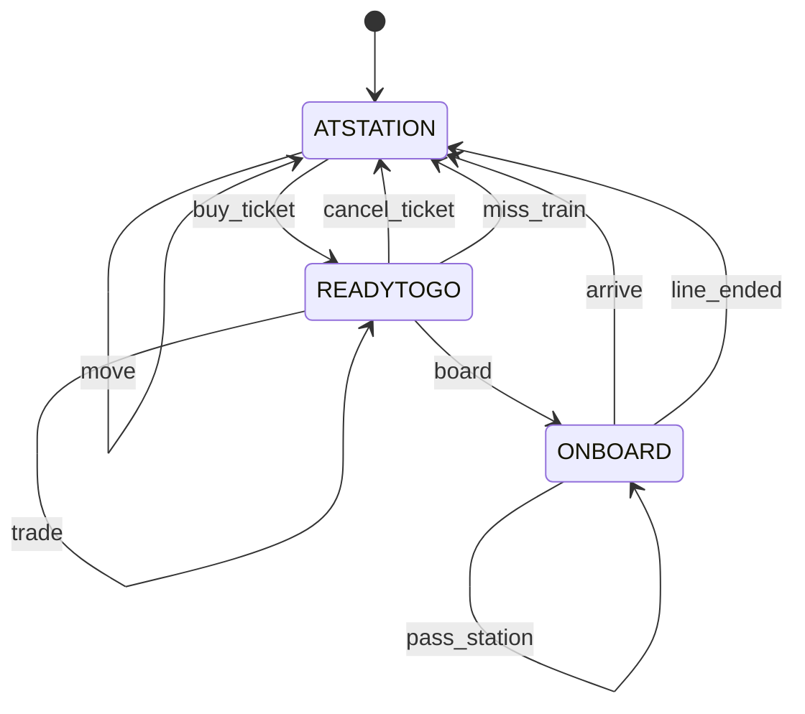
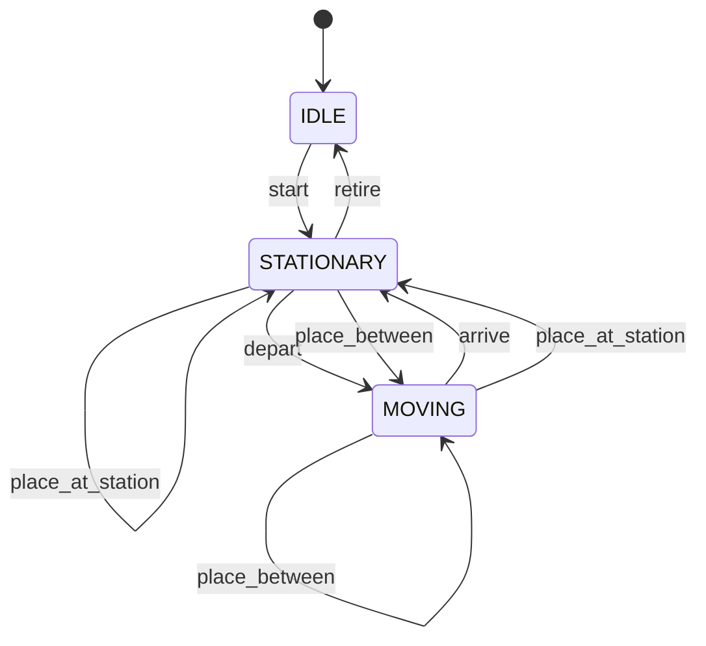
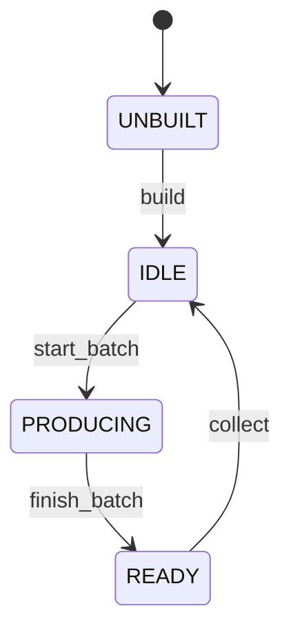
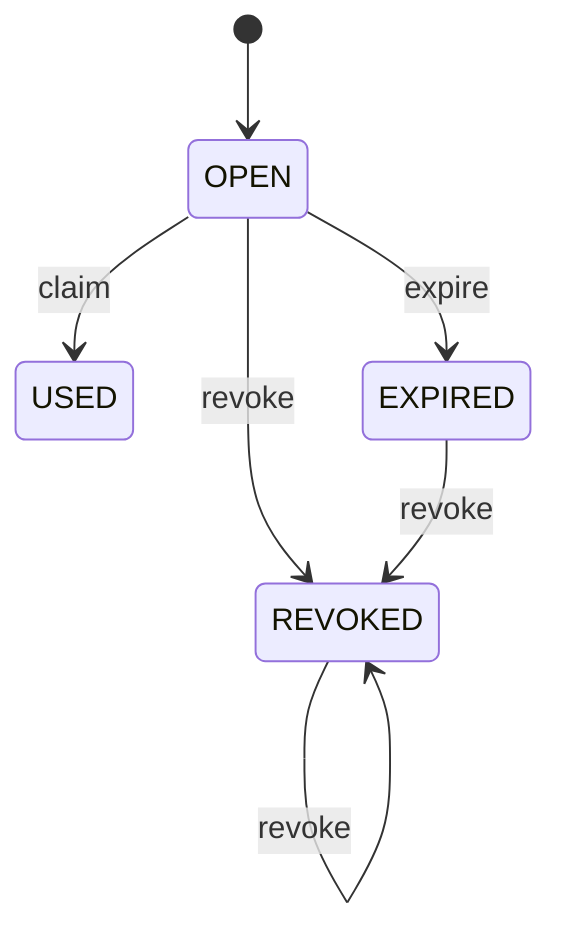
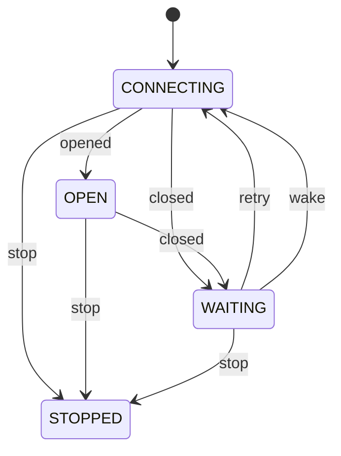
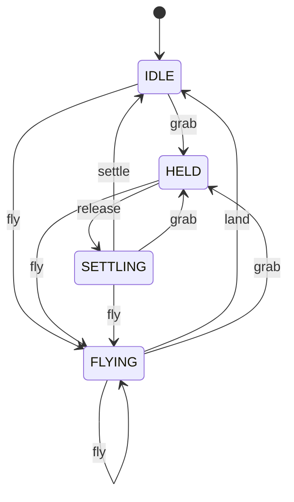

# State machines

<!-- Generated from src/machines/ by `npm run machines`. Don't edit by hand: a test fails if this drifts from the code. -->

Every part of Aboard that moves through states is modelled as an explicit state machine in `src/machines/`: a typed table of states, the events each state accepts and where they lead, and the message for each event a state refuses. The server and the web app both use these tables, so a rule (and its wording) lives in one place.

To change a rule: edit the machine, run `npm run machines` to regenerate this page, and run the tests (`test/machines.test.ts` checks every machine is well-formed).

- **In code:** `machine.expect(state, event)` returns the next state or throws the refusal as a `GameError` (HTTP 409 unless the table says otherwise); `machine.can(state, event)` asks without throwing; `machine.accepts(state)` lists what a state allows.

## Traveller

Where a player is in a journey: free at a station, holding a ticket and waiting on the platform, or riding a train.

**Stored in:** users.state (with users.ticket_id and users.current_stop_id)

| State | Meaning | Accepts |
| --- | --- | --- |
| `ATSTATION` | At a station with no ticket: can buy a ticket, trade, and (at home) use the warehouse and factories. | `buy_ticket` → `READYTOGO`, `trade` → `ATSTATION`, `choose_station` → `ATSTATION`, `move` → `ATSTATION` |
| `READYTOGO` | Holding a ticket, waiting on the platform for the train. Can still trade, or cancel for a refund. | `board` → `ONBOARD`, `cancel_ticket` → `ATSTATION`, `miss_train` → `ATSTATION`, `trade` → `READYTOGO` |
| `ONBOARD` | Riding a train. Set down automatically at the destination (or wherever the line ends). | `pass_station` → `ONBOARD`, `arrive` → `ATSTATION`, `line_ended` → `ATSTATION` |

| Event | When |
| --- | --- |
| `buy_ticket` | Buy a ticket |
| `cancel_ticket` | Cancel the ticket |
| `board` | Board the train (when it's at the platform) |
| `miss_train` | The train leaves without you |
| `pass_station` | The train moves on |
| `arrive` | Get off at the destination |
| `line_ended` | The line ends; everyone gets off |
| `trade` | Buy, sell, load, unload or build |
| `choose_station` | Choose where to start (admins, or anyone not yet anywhere) |
| `move` | An admin moves the player |

Refusals (what the player is told):

- `buy_ticket`: "You already have a ticket."
- `cancel_ticket` in `ATSTATION`: "Ticket not found." (HTTP 404)
- `cancel_ticket` in `ONBOARD`: "You can only cancel before boarding."
- `trade`: "You can only trade at a station, not on the train."
- `choose_station`: "You can't change station while you have a ticket."
- `move`: "They have a ticket; they can't be moved now."

## Train

A train running a line, moved by the world clock every 5 minutes. Lines run both ways: at the end of the line a train turns around onto the line's return twin.

**Stored in:** trips.state (with trips.active, trips.route_id, trips.stop_index, trips.progress)

| State | Meaning | Accepts |
| --- | --- | --- |
| `IDLE` | Not running (never started, or retired at the end of a line with no return run). | `start` → `STATIONARY` |
| `STATIONARY` | Standing at stop_index; progress = minutes waited there. Passengers board and get off now. | `dwell` → `STATIONARY`, `depart` → `MOVING`, `turn_around` → `STATIONARY`, `retire` → `IDLE`, `place_at_station` → `STATIONARY`, `place_between` → `MOVING` |
| `MOVING` | Between stop_index and the next station; progress = km travelled since leaving. | `travel` → `MOVING`, `arrive` → `STATIONARY`, `place_at_station` → `STATIONARY`, `place_between` → `MOVING` |

| Event | When |
| --- | --- |
| `start` | Start from the first station |
| `dwell` | Wait at the platform (a tick shorter than the station's dwell time) |
| `depart` | Leave for the next station (the dwell time is up) |
| `travel` | Run on towards the next station |
| `arrive` | Reach the next station |
| `turn_around` | At the end of the line, switch to the return run and wait again |
| `retire` | At the end of a line with no return run, stop |
| `place_at_station` | An admin puts the train at a station |
| `place_between` | An admin puts the train partway along a segment |

Refusals (what the player is told):

- `start`: "Trip is already running."
- `place_at_station` in `IDLE`: "Start the trip first."
- `place_between` in `IDLE`: "Start the trip first."

## Factory

One of a player's factories in Berlin. A batch takes inputs from the warehouse when it starts, and puts the output in the warehouse when it's collected (on the world tick, or when the player next looks).

**Stored in:** derived from factories (no row = UNBUILT; batch_ready_at null = IDLE; in the future = PRODUCING; past = READY)

| State | Meaning | Accepts |
| --- | --- | --- |
| `UNBUILT` | No factory yet. | `build` → `IDLE` |
| `IDLE` | Built, nothing in production. | `start_batch` → `PRODUCING` |
| `PRODUCING` | A batch is running until batch_ready_at. | `finish_batch` → `READY` |
| `READY` | The batch is done; its output is delivered to the warehouse on collection. | `collect` → `IDLE` |

| Event | When |
| --- | --- |
| `build` | Build the factory (credits and materials from the warehouse) |
| `start_batch` | Start a production batch (inputs leave the warehouse) |
| `finish_batch` | The batch's time is up |
| `collect` | Deliver the output to the warehouse |

Refusals (what the player is told):

- `build`: "You already have this factory."
- `start_batch` in `UNBUILT`: "Build this factory first."
- `start_batch` in `PRODUCING`: "A batch is already in production."
- `start_batch` in `READY`: "A batch is already in production."

## Invite

A one-time signup code an admin shares as a link. Aboard is invite-only.

**Stored in:** derived from invites (used_by/used_at = USED, revoked_at = REVOKED, expires_at in the past = EXPIRED)

| State | Meaning | Accepts |
| --- | --- | --- |
| `OPEN` | Can be used to sign up, once. | `claim` → `USED`, `revoke` → `REVOKED`, `expire` → `EXPIRED` |
| `USED` | Someone signed up with it (shown to admins with their username). | nothing (final) |
| `REVOKED` | An admin withdrew it. | `revoke` → `REVOKED` |
| `EXPIRED` | Its time ran out unused. | `revoke` → `REVOKED` |

| Event | When |
| --- | --- |
| `claim` | Sign up with it |
| `revoke` | An admin withdraws it |
| `expire` | Its expiry passes |

Refusals (what the player is told):

- `claim` in `USED`: "That invite has already been used."
- `claim` in `REVOKED`: "That invite has been withdrawn."
- `claim` in `EXPIRED`: "That invite has expired."
- `revoke` in `USED`: "That invite has already been used."

## Live connection

The app's WebSocket for live updates. When it drops, the app retries with backoff (sooner when the tab comes back), keeps polling meanwhile, and refetches everything once it's back. Players see a small 'Reconnecting' note while it's down.

**Stored in:** in memory, in web/src/live.ts

| State | Meaning | Accepts |
| --- | --- | --- |
| `CONNECTING` | Opening the socket. | `opened` → `OPEN`, `closed` → `WAITING`, `stop` → `STOPPED` |
| `OPEN` | Live: events arrive as they happen. | `closed` → `WAITING`, `stop` → `STOPPED` |
| `WAITING` | Dropped; waiting out a backoff (1–30 s) before trying again. | `retry` → `CONNECTING`, `wake` → `CONNECTING`, `stop` → `STOPPED` |
| `STOPPED` | Closed on purpose (signed out, or the app unmounted). | nothing (final) |

| Event | When |
| --- | --- |
| `opened` | The socket opens |
| `closed` | The socket closes or fails |
| `retry` | The backoff is over |
| `wake` | The tab becomes visible again |
| `stop` | Close it for good |

## Camera

The globe's camera. Screens steer it (useWorldFocus), selecting a train, line or station flies to it, and the player can grab it. When idle it follows your train if there is one, slowly drifts if the screen has no centre, and otherwise rests. The world draws at full frame rate while the camera is held, flying, or just let go; at 15 fps otherwise.

**Stored in:** in memory, in web/src/world3d/World3D.tsx

| State | Meaning | Accepts |
| --- | --- | --- |
| `IDLE` | Following your train, drifting slowly, or resting, depending on the screen. | `grab` → `HELD`, `fly` → `FLYING` |
| `HELD` | The player is dragging or zooming. | `release` → `SETTLING`, `fly` → `FLYING` |
| `SETTLING` | Just let go: stays where the player left it for 6 s. | `settle` → `IDLE`, `grab` → `HELD`, `fly` → `FLYING` |
| `FLYING` | Animating to a new view (about 1.4 s). | `land` → `IDLE`, `grab` → `HELD`, `fly` → `FLYING` |

| Event | When |
| --- | --- |
| `grab` | The player starts dragging or zooming |
| `release` | The player lets go |
| `settle` | 6 s pass after letting go |
| `fly` | A screen or a selection asks for a new view |
| `land` | The flight ends |

